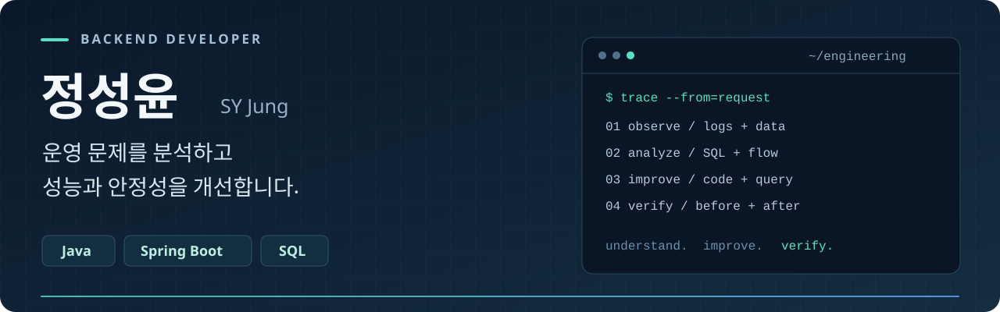

[README.md](https://github.com/user-attachments/files/33694232/README.md)

  <picture>
    <source media="(max-width: 600px)" srcset="./assets/profile-banner-mobile.svg" />
    
  </picture>

  <a href="#work-experience">실무 경험</a> &nbsp;·&nbsp;
  <a href="#career">경력</a> &nbsp;·&nbsp;
  <a href="#projects">개인 프로젝트</a> &nbsp;·&nbsp;
  <a href="#tech-stack">기술 스택</a>

## 안녕하세요, 백엔드 개발자 정성윤입니다.

Java와 Spring Boot를 기반으로 **운영 중인 서비스의 문제를 분석하고, 성능과 안정성을 개선**합니다.
HMG DX 플랫폼, 공공기관 검인정 심사 시스템, 대학 온라인 시험 시스템에서 기능 개발과 운영 장애 대응을 담당했습니다.

- **흐름을 따라 원인을 찾습니다.** 로그, SQL, 외부 API를 함께 살펴보고 요청이 지연되거나 실패하는 지점을 확인합니다.
- **변경의 영향을 검증합니다.** 기존 조회 결과와 업무 흐름을 유지하면서 성능과 처리 구조를 개선합니다.
- **AI를 개발과 검수에 활용합니다.** 요구사항과 제약을 먼저 정리하고, 제안된 코드의 이유와 예외 상황을 검토합니다.

## 실무에서 해결한 문제

### 01. HMG DX · 예매·결제 개발과 성능·보안 개선

**신규 예매·PG 연동 · SQL 튜닝 · 인증·보안 강화**

사용자·관리자 백엔드의 신규 기능 개발과 유지보수를 담당했습니다. N드라이브 예매·PG 연동, 예매 정책 구현, 인증·개인정보 보호 기능 개발과 운영 장애 대응을 수행했습니다.

**대표 개선 사례 · 예약 조회 병목 분석과 SQL 튜닝**

**개별 예약 조회 AJAX 요청: 약 3.0–3.1초 → 약 1.0–1.1초**

예약 오픈 시간대의 간헐적인 예약 실패를 조사했습니다. DB 커넥션 풀 대기 타임아웃과 Slow SQL을 확인하고, 예약부터 결제·알림까지 요청 흐름을 추적해 예약 조회 구간의 지연을 분석했습니다.

반복 집계와 상관 서브쿼리를 JOIN 기반으로 재구성하고, 회차 요약 연산을 WITH 절로 분리했습니다. 실행계획과 조회 조건에 맞춰 인덱스를 개선한 뒤 동일 요청의 튜닝 전후를 비교했습니다.

위 수치는 개별 예약 조회 요청 구간의 측정 결과입니다. 예약부터 결제까지의 전체 처리 시간을 뜻하지 않습니다.

<b>담당 역할과 추가 개선 내용</b>

- **회사 / 기간:** ㈜이지미디어 · 2024.09 ~ 현재
- **역할:** 백엔드 신규 기능 개발·유지보수, SQL 튜닝, 인증·보안 개선, 운영 장애 분석
- **기술:** Java · Spring Boot · MyBatis · Tibero · JSP · JavaScript · JUnit · Mockito · JaCoCo · SonarQube

**예매·결제 및 외부 시스템 연동**

- N드라이브 신규 예매 기능 개발 및 PG사 연동·결제 분기 처리 구현
- 현장예매 기능과 프로그램별 레벨·나이 제한, 동일 프로그램 재예매 제한, 연간 예매 횟수 제한 로직 구현
- 카카오 알림톡·비즈메일 API 연동, 포인트 자동 발송 및 마이페이지 만족도 조사 연동 기능 개발

**인증·개인정보 보호 및 웹 접근성**

- HMG ID 2.0·Pleos 로그인 연동 및 중복 로그인 방지·CAPTCHA·이메일 인증 기능 개발
- 고객식별값(CI) AES 암호화 저장을 위한 유틸리티·MyBatis TypeHandler 구현 및 관련 기록 테이블 신설, Jasypt를 활용한 설정값 암호화 적용
- XSS·Open Redirect·CSRF 관련 취약점 조치, 비밀번호 변경·요청 매개변수 검증 강화 및 ISMS 인증 대응을 위한 개인정보 처리 보완
- 팝업 포커스, 대체 텍스트, 키보드 탐색, 색상 대비 등 웹 접근성 개선

**운영 안정화·코드 품질 및 협업**

- 배치·예매 처리 모니터링, 예매·결제 실패 시 이메일 장애 알림 및 외부 API 공통 로깅 유틸리티 개발
- 공통 시퀀스 서비스를 개발해 기존 ID 생성 방식을 시퀀스 기반으로 전환
- JUnit·Mockito 기반 Controller 테스트 코드 작성 및 JaCoCo 커버리지 측정 환경 설정
- 사용자·관리자 서비스의 SonarQube 정적 분석 지적 사항 **약 5,200건 조치** — Bug, Critical 등급 이슈, Security Hotspot 포함
- 오픈소스 라이브러리 업데이트 및 Black Duck 라이선스 점검 결과 조치
- 고객사 요구사항 분석, 변경 영향 검토, 공수 산정 및 기획·프론트엔드와 작업 범위 조율
- AI를 활용한 테스트 코드 작성·enum 전환 리팩터링 및 반복 구현 작업 수행

**추가 성능 개선 · 개별 AJAX 요청 기준**

- 쿠폰 조회: **30초 → 0.1초**
- 예매 상품·회차 관리: **9초 → 0.1초**
- 예매 정산: **39초 → 10초**
- 예매 페이지 내 요청: **6초 → 2초**

각 수치는 해당 AJAX 요청 구간의 측정 결과입니다. 병목 분석 과정과 튜닝 전후 측정 결과는 포트폴리오로 문서화했습니다.

**진행 중 · 2026.10 기준**

- NetFunnel 대기열 시스템 연동 및 대기 화면·중지 기능 개발

### 02. 공공기관 검인정 심사 시스템 · 파일 처리와 인증·보안 개선

**파일 처리 흐름 정비 · OTP 인증 개발 · 클라우드 이전 검증**

분산돼 있던 파일 업로드·다운로드 처리를 Java Controller 중심으로 정리했습니다. 구글 OTP와 심사 업무 API를 개발하고 CORS·SSL·세션 보안 설정을 개선했습니다. 온프레미스에서 NCP·Tibero 환경으로 이전하는 과정에서는 DB 마이그레이션과 WAS 연동을 검증했습니다.

<b>담당 역할과 작업 범위</b>

- **회사 / 기간:** ㈜타이드플로 · 2023.02 ~ 2024.04
- **역할:** 백엔드 유지보수, 기능 개선, 보안 점검 대응, 클라우드 이전 관련 개발·검증
- **파일 처리:** 기존 업무 방식을 유지하며 업로드·다운로드 구조 개선 및 동작 확인
- **인증:** 기존 로그인 흐름과 충돌하지 않도록 OTP 인증 성공·실패 상황 검증
- **연동:** WAF·CORS 차단 이슈를 외부 협력사와 함께 분석·대응
- **고도화:** AI 디지털교과서 검정 요구사항 반영, S3 호환 Object Storage 테스트 환경 구성, CI/DI 기반 중복 가입 방지
- **기술:** Java · Spring Boot · Oracle · Tibero · NCP · Object Storage · JSP · JavaScript

### 03. KNU9 대학 온라인 시험 시스템 · 로그인 장애 대응

**대학 API·DB 데이터 대조로 동기화 오류 분석 · 긴급 조치 후 서버 검증 보완**

대학 API와 DB 데이터를 대조해 학번 동기화 오류를 분석하고 로그인 장애에 대응했습니다. 별도의 로그인 실패 횟수 제한 작업은 시험 기간에 우선 적용한 뒤, 시험 종료 후 서버 검증 로직과 예외 상황을 보완했습니다.

<b>담당 역할과 운영 경험</b>

- **회사 / 기간:** ㈜타이드플로 · 2023.06 ~ 2024.01
- **역할:** 시험 시스템 백엔드 유지보수, 로그인 장애 분석, 시험 기간 운영 대응
- 시험 응시·로그인·성적 조회 기능 유지보수 및 일부 프론트엔드 기능 개선
- 시험 기간 서버 모니터링과 운영 이슈 대응
- 긴급 대응과 운영 안정화 이후의 보완 작업을 구분해 진행
- **기술:** Java · Spring Boot · MySQL · JSP · JavaScript

## 경력

| 기간 | 회사 · 역할 | 담당 업무 |
| :--- | :--- | :--- |
| 2024.09 ~ 현재 | **㈜이지미디어** · 운영연구개발팀 / 주임 | HMG DX 예매·결제 개발, SQL 튜닝, 인증·보안 개선, 운영 안정화 |
| 2023.02 ~ 2024.04 | **㈜타이드플로** · 서비스 1파트 / 매니저 | 공공기관 심사·대학 시험 시스템, 인증·보안 개선, 클라우드 이전 대응 |
| 2020.02 ~ 2021.01 | **보보스링크㈜** · SBRK / 사원 | 소프트뱅크로보틱스코리아 파견, 제품 로그 수집·집계·리포팅 자동화 |
| 2019.06 ~ 2020.01 | **무한비트** · FOCS팀·영업부 / 사원 | Java/JSP 쇼핑몰 백엔드·DB 설계, 프로그램·방화벽 QA / 일학습병행 |

<b>로그 자동화와 초기 개발 경험</b>

**제품 로그 자동화 · 보보스링크㈜ / 소프트뱅크로보틱스코리아 파견**

- 프로젝트 기간: 2020.03 ~ 2020.12 · 단독 개발
- Google Apps Script로 CSV 로그 수집·파싱 및 일별 주요 지표 집계 자동화
- 버튼 기반 통계 시트 생성, 날짜별 파일 저장, 이메일 자동 발송 구현
- Google Sheets 차트로 오류 추이를 시각화해 제품 개선 논의에 활용

**쇼핑몰 백엔드 · 무한비트**

- 프로젝트 기간: 2019.09 ~ 2019.12 · 일학습병행
- 회원·상품·주문 중심의 MySQL 스키마와 테이블 설계 및 DB 연동
- Java/JSP 회원가입·로그인과 관리자·사용자 권한별 기능 제어 구현
- 프론트엔드 담당자와 기능 인터페이스 조율 및 유지보수

실무 프로젝트는 담당 역할과 문제 해결 경험을 중심으로 소개합니다. 아래 개인 프로젝트에서 공개 코드를 확인할 수 있습니다.

## 개인 프로젝트

### [toss-invest](https://github.com/dkffprtm0404-rgb/toss-invest)

**자연어 전략을 확인하고, 버전과 실행 근거를 남기는 투자 전략 백엔드**

`Java 17` `Spring Boot` `H2` `Codex`

- 자연어 입력 → 매매 조건 확인·보완 → 전략 저장 → 백테스트 → 실행 이력 조회
- 전략이 바뀌어도 과거 실행 조건을 확인할 수 있도록 **전략 버전과 실행 시점의 입력·결과를 보존**
- 백테스트, 페이퍼 트레이딩, 실행 결과 차트와 거래 근거 조회 구현
- **AI 해석과 실행을 분리**하고, 사용자가 조건을 확인하는 단계를 구성

[코드와 실행 방법 →](https://github.com/dkffprtm0404-rgb/toss-invest) &nbsp;·&nbsp; [전략·실행 결과 저장 구조 →](https://github.com/dkffprtm0404-rgb/toss-invest/blob/master/.docs/strategy-persistence.md)

### [MyShop · VibeCodingUsingAI](https://github.com/dkffprtm0404-rgb/VibeCodingUsingAI)

**상품 데이터 기반 AI 추천을 결합한 패션 쇼핑몰**

`Next.js` `TypeScript` `Supabase` `Claude API` `Docker`

- 상품 탐색·상세, 장바구니, 인증, 주문 데이터 저장·조회 구현
- 상품 정보를 활용한 AI 챗봇과 설문 기반 스타일 진단·코디 추천
- Supabase Auth와 RLS를 활용한 사용자별 데이터 접근 제어
- 계획·구현·검토 역할을 나눠 AI와 협업하는 개발 방식 실험

[코드와 프로젝트 소개 →](https://github.com/dkffprtm0404-rgb/VibeCodingUsingAI)

## 기술 스택

  

| 구분 | 활용 기술 |
| :--- | :--- |
| **실무 · 백엔드** | Java, Spring Boot, Spring MVC, MyBatis, JSP, REST API |
| **실무 · 데이터** | Oracle, Tibero, MySQL, SQL 튜닝, 실행계획·인덱스 분석 |
| **실무 · 테스트·품질** | JUnit, Mockito, JaCoCo, SonarQube, Black Duck |
| **실무 · 운영·협업** | Git, NCP 이전 대응, 외부 API 연동, 장애 모니터링 |
| **실무 · 웹·자동화** | JavaScript, jQuery, Google Apps Script, Google Sheets |
| **개인 프로젝트** | Next.js, TypeScript, Supabase, H2, Docker, Claude API, Codex |

## 개발할 때 중요하게 생각하는 것

**분석 → 변경 범위 결정 → 구현 → 검증 → 기록**

문제가 발생하면 요청 흐름과 데이터를 먼저 확인합니다. 긴급 대응 이후에도 예외 상황과 기존 기능의 영향을 다시 검토하고, 수정 이유와 확인 기준을 남깁니다. AI로 반복 작업을 줄이고, 확보한 시간을 테스트와 결과 검수에 사용합니다.

<b>학습과 자격</b>

- 한양사이버대학교 응용소프트웨어공학과 재학 · 2023.03 ~
- 정보처리기사 · 2025.12
- SQL개발자(SQLD) · 2023.07
- 정보처리산업기사 · 2019.09
- 리눅스마스터 2급 · 2018.12

---

문제의 원인을 설명하고, 변경의 결과를 확인하는 개발을 지향합니다.

